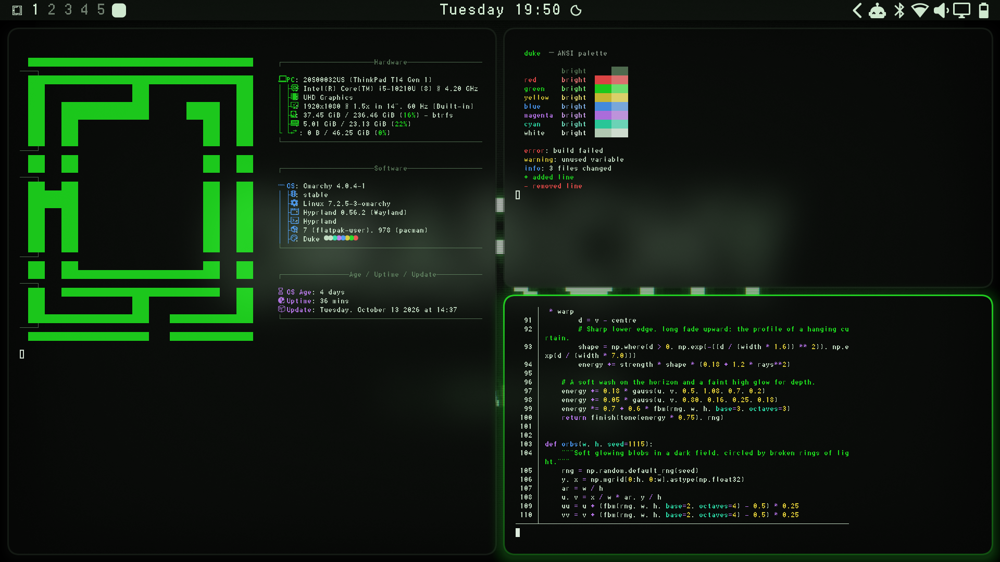

# Duke

An [Omarchy](https://omarchy.org) theme inspired by the 2001 console aesthetic:
near-black panels with a faint green cast, one vivid green accent, and frosted
glass everywhere — blurred translucent windows, terminals, bar, launcher and
notifications over glowing green wallpapers.



The name is a nod to the big original controller. This is an unofficial fan
theme; it contains no logos or trademarked imagery, and every wallpaper is
generated procedurally by [`tools/generate-backgrounds.py`](tools/generate-backgrounds.py).

## Install

Requires Omarchy 4 (Hyprland with the Lua config and the Quickshell bar).

> **Don't use `omarchy theme install <url>` for this theme.** Omarchy treats a
> theme cloned that way as untrusted and strips every `*.lua` file and the
> terminal configs (`alacritty.toml`, `foot.ini`, `ghostty.conf`, `kitty.conf`),
> regenerating opaque ones from `colors.toml`. Those are exactly the files that
> carry the blur, the window translucency and the terminal transparency. You'd
> get the palette and wallpapers, but none of the glass.
>
> The same rule applies to **any** theme directory under
> `~/.config/omarchy/themes/` that contains a `.git` folder. A plain
> `git clone` straight into `~/.config/omarchy/themes/duke` gets stripped the
> same way. Clone somewhere else and symlink it in; Omarchy trusts a symlinked
> theme directory as your own.

```bash
# 1. Clone anywhere outside the themes directory
git clone https://github.com/Cyber-Oak/omarchy-duke-theme.git ~/Projects/omarchy-duke-theme

# 2. Link it in as "duke"
ln -sfn ~/Projects/omarchy-duke-theme ~/.config/omarchy/themes/duke

# 3. Apply it (or pick "Duke" in Omarchy Menu → Style → Theme)
omarchy theme set duke
```

The symlink is also the development setup. Edit files in the checkout, then
run `omarchy theme set duke` again to restage them. Updating is just
`git pull` followed by `omarchy theme set duke`.

If you'd rather not keep a symlink, copy the files without `.git`:

```bash
mkdir -p ~/.config/omarchy/themes/duke
git -C ~/Projects/omarchy-duke-theme archive HEAD | tar -x -C ~/.config/omarchy/themes/duke
omarchy theme set duke
```

To uninstall, switch to another theme and `rm ~/.config/omarchy/themes/duke`.

### Bar transparency

The bar is tinted glass (`shell.bar.toml`, alpha 0.6). Omarchy also has its own
fully transparent bar mode. When that mode is on, the bar draws no background,
so no theme tint can reach it. Turn it off in Omarchy Menu → Style → Bar →
Transparency to see the frosted strip.

## What's in it

| File | Role |
|---|---|
| `colors.toml` | The palette. Everything Omarchy generates (btop, chromium, gum, neovim, helix, …) derives from it. |
| `hyprland.lua` | Borders, Hyprland blur (size 9, 3 passes), green-tinted shadows, rounding, animations, window opacity, blur layer rules for the shell surfaces. |
| `ghostty.conf` `alacritty.toml` `kitty.conf` `foot.ini` | Palette plus background alpha 0.72 and a blur request. The alpha applies to the cell background only, so text stays fully opaque. |
| `shell.*.toml` | Translucent bar, launcher, menu, notifications, popups, plus the tooltip, polkit and lock surfaces. Each file replaces its whole section of the generated `shell.toml`. |
| `icons.theme` | `Yaru-olive` icons. |
| `backgrounds/` | Three generated wallpapers, 3840×2160: aurora, orbs, and a near-black minimal variant. |

The glass recipe (blur size 9 / 3 passes, alpha on the terminal cell
background only, layer rules for the shell) follows
[devsviat/omarchy-abstract-black-theme](https://github.com/devsviat/omarchy-abstract-black-theme).

## Palette

| | | |
|---|---|---|
| background `#0a0c0a` | foreground `#cfe8cf` | accent `#1fe81f` |
| selection `#174a17` | muted `#5a7a5a` | lighter bg `#141a14` |

ANSI: red `#ff4d4d`, yellow `#e6d23a`, green `#1fe81f`, cyan `#2ee6b0`,
blue `#4d9fff`, magenta `#c77dff`, orange `#ff9933`, with matching brights.
Green and cyan lean into the accent. Red, yellow and blue keep clear hue
separation so errors, warnings and info stay distinguishable. Every ANSI colour
has at least 6:1 contrast against the background.

## Regenerating

```bash
# Terminal configs, after editing colors.toml (uses Omarchy's own templates)
tools/generate-terminals.sh

# Wallpapers (deterministic seeds)
python3 -m venv .venv && .venv/bin/pip install pillow numpy
.venv/bin/python tools/generate-backgrounds.py            # 3840x2160
.venv/bin/python tools/generate-backgrounds.py --width 1920 --height 1080

# preview.png: opens three foot windows on workspace 9, screenshots, closes them
# (apply the theme first; nothing else should draw over the wallpaper)
tools/capture-preview.sh
```

`hyprland.lua` is hand-written. If you change `hyprland_active_border` or
`hyprland_inactive_border` in `colors.toml`, update the two border values at
the top of `hyprland.lua` to match.

## License

MIT. See [LICENSE](LICENSE).
